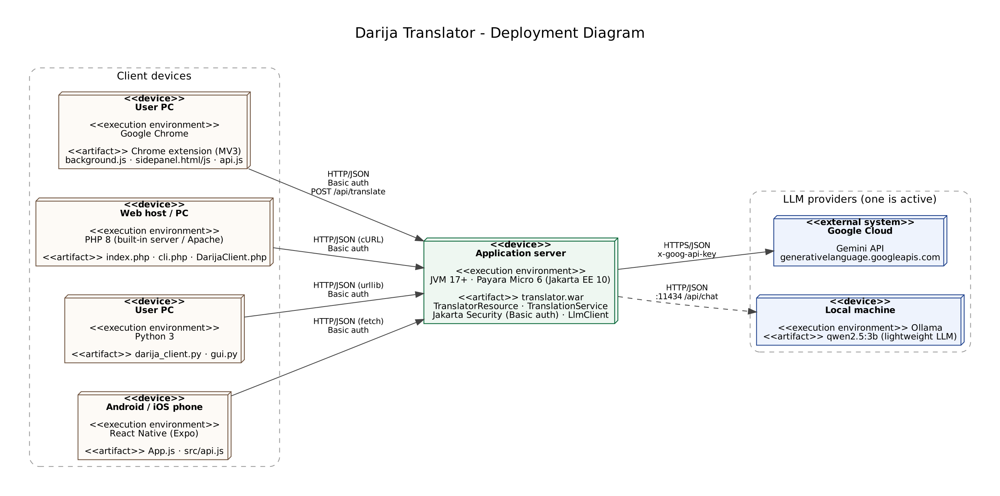

# Darija Translator: LLM-powered RESTful Web Service

Mini Project 2. A Jakarta RESTful web service that translates any language into
**Moroccan Arabic (Darija)** using a Large Language Model (Google Gemini, or a local
lightweight model through Ollama). The service is secured with **Jakarta Security / Jakarta
Authentication (HTTP Basic)** and is consumed by four clients:

| Client | Folder | Tech |
|---|---|---|
| Chrome extension | `chrome-extension/` | Manifest V3, `chrome.sidePanel`, context menu, speech-to-text, text-to-speech |
| PHP client | `php-client/` | PHP 8 + cURL (web page and CLI) |
| Python client | `python-client/` | Python 3 standard library (CLI) + Tkinter GUI |
| Mobile app | `mobile-app/` | React Native (Expo), text-to-speech, clipboard, share |



---

## Features

**Required**
- `TranslatorResource` REST endpoint (Jakarta REST) with the business method `translate()`
- LLM translation via the Google Gemini API (`gemini-2.5-flash` by default, configurable)
- Endpoint secured with Jakarta Security `@BasicAuthenticationMechanismDefinition` and a custom `IdentityStore`
- Chrome MV3 extension in the **side panel**, opened from the **right-click menu**; the selected text is copied into the panel and translated automatically
- PHP, Python and React Native clients
- Tested with Postman (collection included) and cURL (script included)

**Extensions**
- 🔊 **Read aloud** (text-to-speech) in the extension and the mobile app
- 🎤 **Speech input** and **voice-to-voice** mode (speak, translate, hear the Darija) in the extension
- 🖥️ **Local lightweight LLM**: set `LLM_PROVIDER=ollama` to use e.g. `qwen2.5:3b` with no API key
- 📦 **Embedded container**: runs on Payara Micro (single jar, no app-server install)
- Arabic script **or** 3arabizi (Latin letters, e.g. `labas 3lik`)
- Source-language hint or auto-detection, LRU cache, history, copy/share, keyboard shortcut `Ctrl+Shift+Y`
- Mock server (`tools/mock_server.py`) to run the clients without Java or an API key

---

## Repository layout

```
server/              Maven WAR project (Jakarta EE 10)
  src/main/java/ma/aui/darija/
    rest/            TranslatorApplication, TranslatorResource, HealthResource, CorsFilter, ErrorMappers
    service/         TranslationService (prompt, validation, cache)
    llm/             LlmClient (interface), GeminiClient, OllamaClient, LlmClientFactory
    security/        SecurityConfig (Basic auth mechanism), TranslatorIdentityStore
    model/           TranslationRequest, TranslationResponse, ErrorResponse
    config/          AppConfig (environment variables)
  src/main/webapp/WEB-INF/  web.xml (security constraint), beans.xml, glassfish-web.xml (role mapping)
  postman/           Postman collection
  run-payara-micro.sh|.bat, test-api.sh
chrome-extension/    MV3 extension (load unpacked)
php-client/          index.php (web), cli.php, DarijaClient.php
python-client/       darija_client.py (library + CLI), gui.py (Tkinter)
mobile-app/          Expo app (App.js, src/api.js)
tools/mock_server.py Mock of the API
docs/uml/            Class, deployment, use case, sequence diagrams (.png/.svg + sources)
docs/                Demo video script, blog post draft
```

---

## 1. Run the REST service

**Requirements:** JDK 17+ and Maven 3.9+. Get a free Gemini API key at <https://aistudio.google.com/apikey>.

```bash
cd server
export GEMINI_API_KEY="your-key"                 # Windows: set GEMINI_API_KEY=your-key
export TRANSLATOR_USERS="student:darija2026"     # user:password[,user2:password2]
./run-payara-micro.sh                            # Windows: run-payara-micro.bat
```

The script builds `target/translator.war`, downloads Payara Micro (once) and starts it.
The API base URL is **`http://localhost:8080/translator/api`**.

You can also deploy `target/translator.war` to a full **Payara Server 6** or **GlassFish 7**.

### Configuration (environment variables)

| Variable | Default | Meaning |
|---|---|---|
| `LLM_PROVIDER` | `gemini` | `gemini` or `ollama` |
| `GEMINI_API_KEY` | (none) | required for Gemini |
| `GEMINI_MODEL` | `gemini-2.5-flash` | any Gemini model id |
| `OLLAMA_URL` | `http://localhost:11434` | Ollama server |
| `OLLAMA_MODEL` | `qwen2.5:3b` | local model (`ollama pull qwen2.5:3b`) |
| `TRANSLATOR_USERS` | `student:darija2026` | Basic-auth accounts |
| `MAX_TEXT_LENGTH` | `5000` | max characters per request |

**Local LLM instead of Gemini:**
```bash
ollama pull qwen2.5:3b
export LLM_PROVIDER=ollama
./run-payara-micro.sh
```

### API

| Method | URL | Auth | Description |
|---|---|---|---|
| `GET` | `/api/health` | public | status + active provider/model |
| `POST` | `/api/translate` | Basic | JSON body `{"text", "sourceLanguage"?, "script"?}` |
| `GET` | `/api/translate?text=...&script=latin` | Basic | same, as query parameters |

```bash
curl -u student:darija2026 -H "Content-Type: application/json" \
     -d '{"text":"Good morning, how are you?","script":"arabic"}' \
     http://localhost:8080/translator/api/translate
```
```json
{
  "originalText": "Good morning, how are you?",
  "translation": "صباح الخير، كيداير؟",
  "sourceLanguage": "auto",
  "targetLanguage": "Moroccan Arabic (Darija)",
  "script": "arabic",
  "provider": "gemini",
  "model": "gemini-2.5-flash",
  "cached": false,
  "durationMs": 812
}
```

Errors return JSON `{"status", "error", "message"}`: **400** for bad input, **401** for missing or wrong credentials, **502** when the LLM fails.

**Testing:** import `server/postman/DarijaTranslator.postman_collection.json` into Postman (it includes test assertions), or run `server/test-api.sh`. To run the unit tests: `cd server && mvn test`.

### How the security works

1. `SecurityConfig` is annotated with `@BasicAuthenticationMechanismDefinition`. Jakarta Security installs an HTTP authentication mechanism, built on the Jakarta Authentication SPI, that reads the `Authorization: Basic` header.
2. `TranslatorIdentityStore` (an `IdentityStore`) checks the username/password against `TRANSLATOR_USERS` (constant-time comparison) and returns the group `translator`.
3. `web.xml` has a `security-constraint` on `/api/translate/*` that requires the `translator` role. OPTIONS is left open for CORS preflight, and `/api/health` stays public. `glassfish-web.xml` maps the group to the role.
4. Unauthenticated requests get **401** before reaching `TranslatorResource`.

---

## 2. Chrome extension

1. Open `chrome://extensions`, enable **Developer mode**, click **Load unpacked**, and select the `chrome-extension/` folder.
2. Select text on any page, **right-click**, and choose **Translate "…" to Darija**. The side panel opens with the text pasted in and translated.
3. Other ways to use it: the toolbar icon opens the panel, `Ctrl+Shift+Y` translates the current selection, and the ⤵️ button grabs the selection.
4. 🎤 speech input (the first time, a tab opens to grant microphone access), 🔊 read aloud, *Voice-to-voice mode* to speak, translate and hear the result automatically.
5. **Server settings** (bottom of the panel): API URL, username, password, and *Test connection*. A non-localhost URL asks for host permission.

## 3. PHP client

```bash
cd php-client
export DARIJA_API_URL=http://localhost:8080/translator/api DARIJA_USER=student DARIJA_PASSWORD=darija2026
php -S localhost:8000          # then open http://localhost:8000
php cli.php "See you tomorrow" # CLI
php cli.php --latin "Thank you"
```

## 4. Python client

```bash
cd python-client
python darija_client.py "Where is the train station?"
python darija_client.py --latin -v "I love Morocco"
python darija_client.py -i     # interactive
python gui.py                  # Tkinter desktop app
```
No `pip install` is needed (standard library only). Settings are passed as flags `--url --user --password` or as environment variables `DARIJA_API_URL`, `DARIJA_USER`, `DARIJA_PASSWORD`.

## 5. React Native mobile app

```bash
cd mobile-app
npm install
npx expo install --fix         # aligns package versions with your Expo SDK
npx expo start                 # scan the QR code with Expo Go
```
- If Expo Go says the project's SDK is not supported, run `npx expo install expo@latest && npx expo install --fix`.
- Open ⚙️ settings to set the server URL. On an **Android emulator** use `http://10.0.2.2:8080/translator/api`. On a **real phone** use your computer's LAN IP (e.g. `http://192.168.1.20:8080/translator/api`), with the phone on the same Wi-Fi.
- Features: translate, Arabic/3arabizi, 🔊 listen (expo-speech), copy, paste, share, history.

## Mock server (no Java, no API key)

```bash
python3 tools/mock_server.py   # same URL, same JSON, same Basic auth; knows a few phrases
```

---

## UML

| Diagram | File |
|---|---|
| Class diagram | [`docs/uml/class-diagram.png`](docs/uml/class-diagram.png) |
| Deployment diagram | [`docs/uml/deployment-diagram.png`](docs/uml/deployment-diagram.png) |
| Use case diagram | [`docs/uml/use-case-diagram.png`](docs/uml/use-case-diagram.png) |
| Sequence diagram (extension → server → LLM) | [`docs/uml/sequence-diagram.png`](docs/uml/sequence-diagram.png) |

The sources (`.mmd` Mermaid, `.dot` Graphviz) are next to the images.

## Design notes

- **Strategy and Factory patterns:** `LlmClient` hides which LLM is used, and `LlmClientFactory` picks Gemini or Ollama from configuration. A new provider only needs one new class.
- **Prompt engineering:** the system instruction forces Darija vocabulary (not Modern Standard Arabic), keeps formatting, outputs only the translation, and treats the input strictly as text (basic prompt-injection protection). `cleanOutput()` removes stray quotes and code fences.
- **No extra libraries:** the server uses only Jakarta EE APIs and the JDK `HttpClient`. The clients use only their platform's standard tools.

## Tech stack

Java 17 · Jakarta EE 10 (REST, CDI, JSON-P, JSON-B, Security) · Payara Micro 6 · Maven · Google Gemini API / Ollama · Chrome Extensions MV3 · PHP 8 · Python 3 · React Native / Expo
